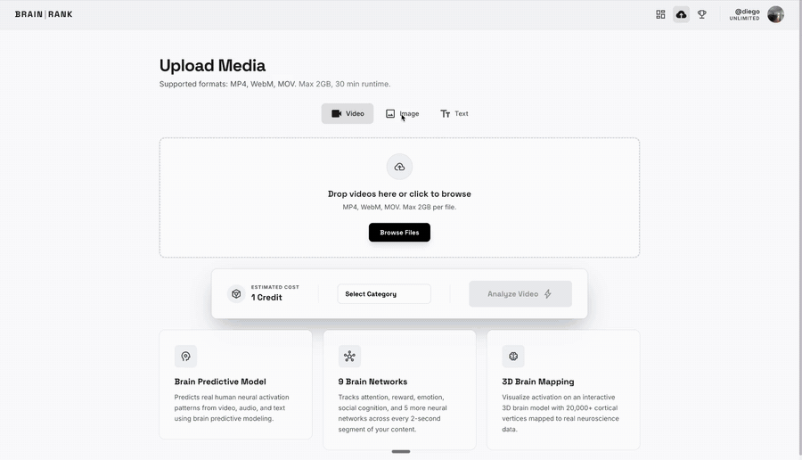
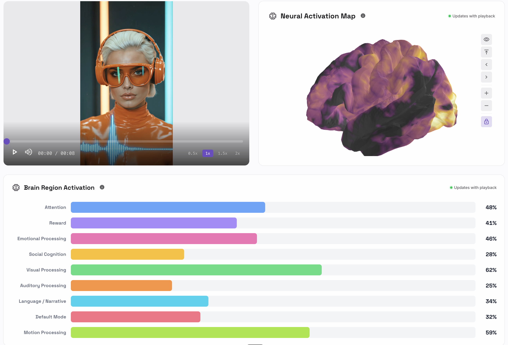

<div align="center">


# BRAIN | RANK

**See what brains see.** Neural A/B testing for content creators.

Upload a video, thumbnail, or script and get back a second-by-second prediction of how a viewer's brain responds — across 9 functional networks, rendered on an interactive 3D cortex.



</div>

---

## What it does

Most creative testing tells you *what* performed after you've already spent the money. BRAIN | RANK predicts *why* before you publish: it runs your content through [TRIBE v2](https://github.com/facebookresearch/tribev2), Meta's brain-encoding foundation model, which predicts fMRI responses across ~20,000 points on the cortex from video, audio, and text.

- **Multi-modal input**: video (up to 90s), images/thumbnails, or plain text scripts
- **9 brain networks**: attention, reward, emotional processing, social cognition, visual, auditory, language/narrative, default mode, and motion
- **Synchronized playback**: scrub the video and watch the 3D brain and network scores update in real time
- **Compare mode**: put two versions side by side and see where one hooks attention and the other loses it
- **Discovery feed**: browse public analyses, bookmark them, and see what lights brains up across the community
- **Credits & billing**: Stripe-powered credit packs and subscriptions

<p align="center">
  
</p>

## Architecture

```
 Next.js app (Vercel)                       GPU inference (RunPod Serverless)
┌───────────────────────────┐   job      ┌───────────────────────────────────────┐
│ Upload → /api/jobs ───────┼──────────▶ │ handler.py                            │
│                           │            │  ├─ fetch video / render image / text │
│ Supabase: auth, jobs,     │  webhook   │  ├─ TRIBE v2 (V-JEPA2 + LLaMA 3.2 +   │
│ profiles, credits ◀───────┼─────────── │  │   Wav2Vec-BERT feature extractors) │
│                           │            │  ├─ fsaverage5 vertices → 9 networks  │
│ Results: three.js cortex, │            │  └─ per-segment scores as JSON        │
│ visx/recharts timelines   │            └───────────────────────────────────────┘
└───────────────────────────┘
```

| Layer | Tech |
|---|---|
| Frontend | Next.js (App Router), React, Tailwind, Framer Motion |
| 3D / charts | three.js via `@react-three/fiber`, visx, Recharts, d3 |
| Auth & data | Supabase (Postgres, Auth, Storage, RLS) |
| Inference | Python worker on RunPod Serverless (A40/A100), CUDA 12.4, PyTorch 2.6 |
| Model | TRIBE v2 (`facebook/tribev2`) |
| Payments | Stripe |
| Infra | Vercel, Upstash Redis rate limiting, PostHog, Resend |

## Repo layout

```
src/            Python inference worker (RunPod handler, TRIBE v2 wrapper, region mapping & scoring)
tests/          pytest suite for the worker
scripts/        container build, endpoint testing, and atlas/mask generation
Dockerfile      GPU container for RunPod Serverless
web/            Next.js app (UI, API routes, Supabase migrations)
docs/           benchmarks, validation reports, deployment guide
ui-specs/       screen-by-screen design specs
.planning/      phase-by-phase build plans and research
```

## Running it

**Web app**

```bash
cd web
cp .env.local.example .env.local   # Supabase, RunPod, Stripe, Upstash, PostHog keys
npm install
npm run dev
```

**Inference worker** (needs a CUDA GPU and a Hugging Face token with LLaMA 3.2 access)

```bash
docker build --build-arg HF_TOKEN=$HF_TOKEN -t brainrank-worker .
```

See [`docs/deployment_guide.md`](docs/deployment_guide.md) for deploying the worker as a RunPod Serverless endpoint.

## Status

BRAIN | RANK ran publicly at trybrainrank.com in 2026 and is no longer live. The code is published here as a portfolio project.

## Notes

TRIBE v2 is released by Meta under **CC BY-NC 4.0**, so any deployment of this project is limited to non-commercial use unless you have other licensing in place. Predictions are model estimates of average brain responses, not measurements of any individual viewer.

---

Built by [Diego Fill](https://diegofill.com).
